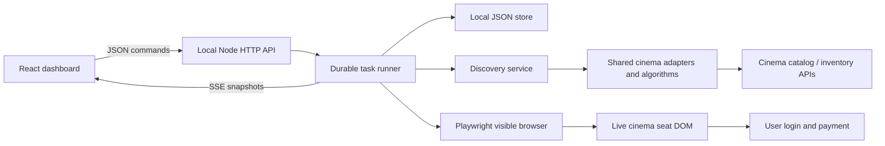

# Standalone architecture

Updated 2026-11-16 for the migration from Chrome extension to local bot and dashboard.

## Runtime boundaries

The Node process owns task execution. Dashboard disconnects do not stop jobs. Extension permissions, content scripts, service-worker alarms and `chrome.storage` are not required.

The loopback API validates Host and Origin headers, requires JSON and an explicit dashboard header for mutations, bounds request sizes and restricts browser navigation to supported HTTPS cinema hosts. It does not expose cookies or arbitrary browser commands.

| Component                         | Responsibility                                                      |
| --------------------------------- | ------------------------------------------------------------------- |
| `bot/src/index.ts`                | Runner/browser/store creation, server startup, shutdown             |
| `bot/src/server.ts`               | HTTP commands, SSE snapshots, dashboard assets                      |
| `bot/src/contracts.ts`            | Task/result/snapshot types and runtime validation                   |
| `bot/src/runner.ts`               | Scheduling, cancellation, restoration, branch handoffs and activity |
| `bot/src/store.ts`                | Serialized atomic JSON replacement                                  |
| `bot/src/discovery.ts`            | Date/time/branch/row/tier filtering and candidate ranking           |
| `bot/src/browser.ts`              | Persistent browser, live DOM inventory, verified clicks and handoff |
| `dashboard/src/App.tsx`           | Overview, missions, details, history, activity and settings         |
| `dashboard/src/TaskForm.tsx`      | Instant/scheduled task creation and preferences                     |
| `dashboard/src/SeatInspector.tsx` | Candidate block preview                                             |
| `dashboard/src/api.ts`            | JSON client and reconnecting event stream                           |
| `packages/core/src/`              | Pure existing adapters, blocks, ranking, models and date helpers    |
| `extension/`                      | Optional legacy runtime; domain files re-export shared modules      |

## Task flow

`queued → scheduled/scanning → monitoring/scanning → selecting → awaiting_user/awaiting_payment → completed`

Instant searches without matches wait for input. Monitors without matches or with transient discovery errors schedule another check. Candidates can be inspected or passed to browser selection. The multiple-branch strategy picks one top show per matching branch. Demo tasks cannot book live seats.

Browser selection is serialized across tasks. Cancellation is checked before side effects. The driver opens/reuses a task/show tab, reads live seat attributes and physical spacing, applies constraints, clicks exact seats and verifies selected state. Unknown page states become manual handoffs. `awaiting_payment` requires verified clicks and checkout navigation. Completion is recorded by the user's Mark complete action.

Each task has a nonoverlapping timer and AbortController. Stop cancels future checks and closes an in-progress automation page to cancel pending locator actions. A page already handed over for payment stays open. Resume waits for an aborted operation to settle.

## Persistence and recovery

The versioned JSON store contains tasks, inputs, candidate results, check counts and the latest 100 log events per task. Writes are serialized through temporary-file rename. Browser session data is held separately in a dedicated profile.

At restart, active monitors resume. Interrupted selections become `awaiting_user`; interrupted instant searches become `stopped`. Corrupt or unrecognized state prevents startup instead of silently overwriting saved data.

## Build and verification

Development combines Vite middleware and the bot API on port 4317. Production builds typecheck both app surfaces and emit `bot/dist/index.js` and `dashboard/dist/`. `npm start` serves both.

Vitest covers shared legacy behavior plus new validation, filtering, persistence, cancellation, scheduling and API behavior. Live legacy API tests use a separate opt-in configuration. Playwright runs an isolated local service, dashboard interactions and intercepted cinema-page fixtures; those fixtures do not make real reservations.

[SYSTEM_REVIEW.md](SYSTEM_REVIEW.md) records the earlier extension inspection, not a current standalone implementation review.
